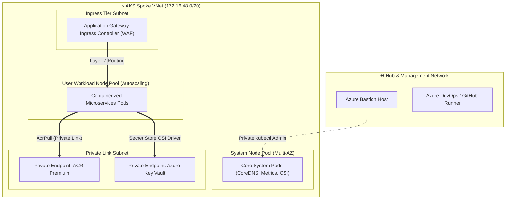

<div align="center">

  

  <p align="center">
    
    
    
    
    
  </p>

</div>

---

## 🏛️ Architecture Overview

This repository delivers an **Enterprise Cloud-Native Kubernetes (AKS) Landing Zone** aligned with the Microsoft Cloud Adoption Framework (CAF) zero-trust baseline.

The cluster operates in **100% Private Mode**, completely eliminating public internet exposure for the Kubernetes API server and worker nodes.



---

## ⚡ Key Highlights

| Pillar | Architecture Scope & Hardening |
| :--- | :--- |
| **🔒 Fully Private Cluster** | The API server uses a private IP address (`privatelink.eastus2.azmk8s.io`); zero direct internet access. |
| **🌐 Azure CNI Networking** | Direct native VNet IP allocation per pod with granular **Azure Network Policies** enforcing zero-trust pod isolation. |
| **🔑 Passwordless Secrets** | **Azure Key Vault Secrets Store CSI Driver** dynamically mounts secrets into pod memory without etcd persistence. |
| **🛡️ Hardened Container Security** | Non-root containers, read-only root filesystems, dropped Linux capabilities, and ACR image content trust. |
| **📦 Production Kubernetes Manifests** | Out-of-the-box production YAML templates for Deployments, Services, Ingress, NetworkPolicies, and SecretProviderClasses. |

---

## 📁 Repository Structure

```text
Enterprise-Azure-AKS-Microservices-Landing-Zone/
├── .github/workflows/
│   └── devsecops-ci-cd.yml       # DevSecOps Pipeline: Terraform & K8s Manifest Validation
├── k8s/
│   └── base/                     # Hardened Kubernetes Production Manifests
│       ├── namespace.yaml
│       ├── deployment.yaml       # Non-root, Read-only Root FS, Probes
│       ├── service.yaml          # ClusterIP
│       ├── network-policy.yaml   # Default Deny Ingress
│       └── secret-provider-class.yaml
├── terraform/
│   ├── modules/
│   │   ├── aks_network/          # Spoke VNet, Subnet Sizing, Private DNS
│   │   ├── aks_cluster/          # Private AKS, Multi-AZ Node Pools, CSI
│   │   └── aks_acr/              # ACR Premium with Private Endpoint
│   └── environments/
│       └── prod/
│           ├── main.tf
│           ├── variables.tf
│           ├── terraform.tfvars
│           └── versions.tf
└── README.md
```

---

## 🚀 Quick Start & Deployment

```bash
cd terraform/environments/prod

# Initialize Terraform
terraform init

# Validate configuration
terraform validate

# Review execution plan
terraform plan

# Apply Landing Zone
terraform apply -auto-approve
```

---

## 👤 Author
**Raghvendra Singh**  
Principal DevSecOps Architect & Enterprise Cloud Strategist  
GitHub: [@raghvendrasingh-devops](https://github.com/raghvendrasingh-devops)  
LinkedIn: [raghvendra-singh-devops](https://linkedin.com/in/raghvendra-singh-devops)
